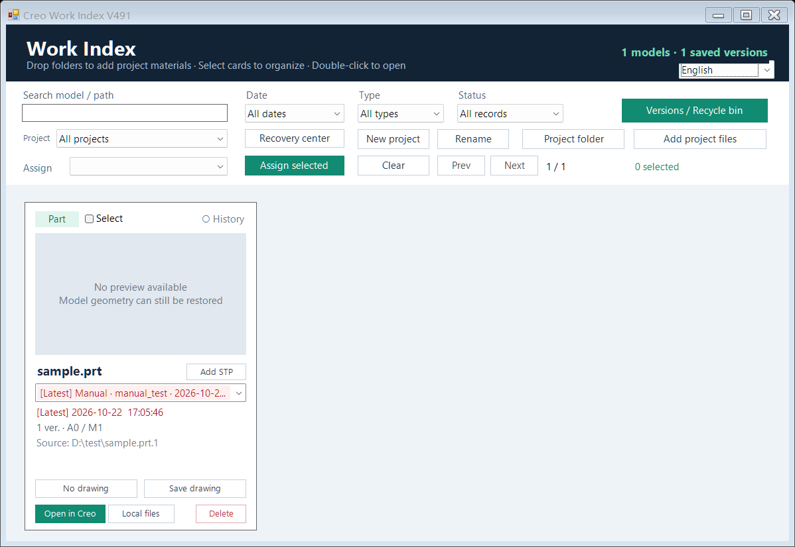

# Creo Work Index

A visual work library for **Creo Parametric 12 and 13 on Windows x64**: save useful model states, find recent work by its preview, and keep project folders within easy reach.

[中文说明](README.zh-CN.md)

## Why I built it

I started with Creo trail-file recovery because losing work after a crash was frustrating. Over several months of everyday use, the tool grew into a work index: model cards, saved versions, drawings, optional autosave and project folders. It helps keep useful recovery points; it does not prevent Creo from crashing.

## Download

- [Chinese Windows package](CreoWorkIndex_V491_Chinese.zip?raw=true)
- [English Windows package](CreoWorkIndex_V491_English.zip?raw=true)

Both are complete installation packages with identical features. Their first-run language differs; an existing saved language choice takes precedence. You can switch between Chinese and English in Work Index, Recovery Center or the launcher's Language menu. Native Creo diagnostics may retain their original language.

This repository distributes the installer, screenshots and documentation. It is not a source-code release.

## Install and try it

1. Extract the package and run **Setup.exe**.
2. Choose separate, empty plugin and work-index folders on an available local drive. Pick the permanent index location carefully: subsequent snapshots and imported project materials are managed there.
3. Select the detected **Creo 12 or 13** installation and your usual startup `config.pro`. Browse to `parametric.exe` and the config manually if needed.
4. Install, save your current Creo work, and restart Creo normally.
5. Open a test part, arrange its view and look for the floating **CREO** launcher. Choose **Save state**, open Work Index and find its card. Use **Open in Creo** to return to a saved version.

The installer is for a fresh installation and refuses nonempty plugin/library folders. Keep existing installations and populated libraries intact; do not delete an old library to satisfy this requirement.

## Prefer deliberate saves

Use **Save state** at useful milestones. Manual quick saves appear as selectable card versions. Drawings can also be saved and linked to their model cards.

Optional autosave defaults to **5 effective design changes**. The system accumulates design-change batches, not clicks. Leaving Creo idle does not increase this counter. Timed saving is also available; a due save waits for changes and safe idle conditions.

Large assemblies, point clouds and STL work can pause while saving. Increase the interval or pause autosave and save manually if this interrupts modeling.

Automatic snapshots rotate between **A/B slots**. Manual quick saves are separate. **Clean quick saves** keeps the latest quick save and permanently removes the specifically listed older local backups; busy-file cleanup can be queued and canceled. Named manual versions, A/B slots and working originals are excluded from that cleanup.

## A small progress indicator

The CREO launcher keeps its original size. With autosave enabled:

- Change mode: only `2/5` beside the icon.
- Timed mode: only `01:20/05:00` below the icon.

Progress comes from the plugin's current counter/timer. Reaching the threshold is not confirmation that a save succeeded. The indicator hides when autosave is off.

Recovery Center has **Ask whether to enable autosave when opening a new model**. It is on by default, asks only for models without a saved protection choice and avoids repeatedly asking about the same model in one session. Turning the question off does not disable existing autosave settings.

## Find work without hunting through folders

Open Creo, then Work Index to see recent work. Organize model cards by project, import entire materials folders, and use **Project folder** to return to them. Folder import copies and verifies files while retaining the originals. Use the imported location for subsequent work.

The internal AI comparison/optimization button is not included in the public model-card interface.

## Validation and feedback

The UI update is checked with isolated fixtures for language switching, saved preferences, counters, prompt choices, filtering, drawings, STP attachments and quick-save cleanup. Native save/restore behavior uses the supplied V508 plugin; test the first-use workflow on each target computer before production use.

Ideas from everyday use are welcome. **Email: zewei2580@gmail.com**
