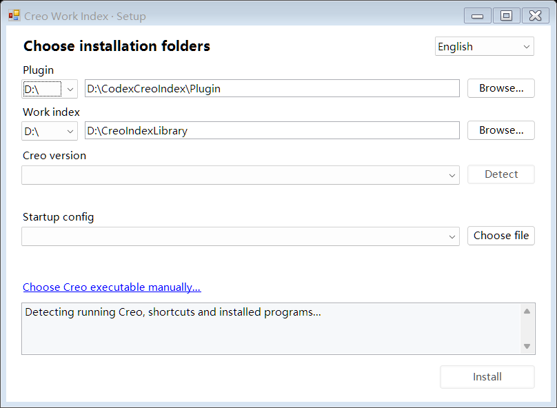
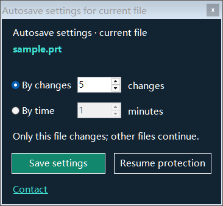

# Creo Work Index

A visual library for recent Creo Parametric work on **Windows x64 with version-specific components for Creo 5–13**. It began as my attempt to recover work after Creo crashes and grew into model cards, saved versions, drawings, project folders and optional autosave. It helps me find and resume a job; it cannot prevent a Creo crash.

[中文说明](README.zh-CN.md)

## Download

- [V574 Chinese unified installer](https://github.com/zewei2580-tech/creo-work-index/releases/download/v574/CreoWorkIndex_Unified_V574_Chinese.zip) · [SHA-256](https://github.com/zewei2580-tech/creo-work-index/releases/download/v574/CreoWorkIndex_Unified_V574_Chinese.zip.sha256)

Contains nine SDK-specific builds for Creo 5–13. Build and installation checks passed; complete live CAD acceptance has not been performed on every version. Old installer files have been removed from the current branch; Git history remains available. This repository distributes installers and usage notes, not software source code.

## Install or upgrade

Extract the ZIP and run **Setup.exe**. For a new installation, select separate empty program and index-library folders on a local drive, then select the detected Creo 5–13 installation and startup configuration. Choose the library location carefully: saved nodes and imported project materials are managed there.

To update an existing installation, choose **Upgrade existing version**. The installer detects the old program, keeps its library and settings, switches the registered DLL, and backs up the previous program files. A failed update rolls back; an interrupted update can be recovered. Save your work and exit Creo and the index interface before installing, then restart Creo.

## First use

Open a test part in Creo, arrange its view, click the floating **CREO** launcher, then choose **Save state**. Open Work Index to find its card and preview. **Open in Creo** opens a working copy of a saved version. If a same-named model or assembly component remains in Creo memory, the restore stops and explains the conflict; closing a window alone may not remove that model from memory.

I prefer a deliberate **Save state** at useful milestones. It normally saves the working file, then copies the saved native files into an independent history node. Automatic versions rotate between A and B; a failed replacement keeps the previous nodes. The saved versions are separate from working originals.

When I save an individual part that belongs to a loaded assembly, the floating prompt offers **Save assembly node** or **Skip**. Choosing it stores a complete assembly node, including identified native components. It does not automatically create a card for every child part. The prompt stays bound to the named assembly even if another model becomes active.

## Autosave for each file

A new file first asks only whether to enable protection. If left unanswered, the prompt closes after about 12 seconds and does not keep reappearing for that file during the same session. Its default is **time mode, checking every 5 minutes; the preset values are 20 changes and 60 seconds idle**. Native change counts are not mouse clicks; an idle model does not accumulate changes. Click **Autosave settings** again to see the current file name and set change-count or time mode and its interval. Other files keep their own settings and continue independently. The same panel can pause or resume that file; successful actions close it. Switching files closes the old file’s panel.

The launcher shows only `2/5` beside the icon in change mode or `01:20/05:00` below it in time mode. Reaching the interval is not proof of a successful save. If a timed check finds no design change, it reports that no save is needed. Large assemblies, point clouds and STL work can stall while being saved; use a longer interval or deliberate saves when that affects modeling.

## Projects and scope

I group the whole project material folder with its project card. Next time I open Creo and Work Index, recent cards show what I have been working on; the project-folder shortcut gets me back to its files. Model cards can also hold drawings.

The earlier V496 workflow was checked locally in Creo 13 with a simple assembly and two parts: native save/copy, assembly prompt after part save, restore conflict handling, A/B replacement failure, and two different file schedules. Complex skeletons, family tables, external references, simplified representations and Windchill-managed models were outside that run. Try the first-use flow on a test project on your computer.

Feedback: **[zewei2580@gmail.com](mailto:zewei2580@gmail.com)**.

## V574 update
Node selection now uses an embedded list to reduce unexpected closing on transient focus changes. Fresh empty libraries include the SP115050 tutorial sample. Existing libraries remain unchanged on upgrade. Error protection offers a 30-day trial and offline activation; autosave and other functions remain free.

## Uninstall
Exit Creo and the protection UI. Extract the complete package and run Uninstall.exe beside uninstall-files.txt. Select the plugin installation folder. The library is kept by default. Only check the permanent library deletion option if you intend to delete all indexed history. Shared VC++ runtimes are retained.

## Compatibility
Use the unified package above. Separate old SDK test installers are no longer the current download.
