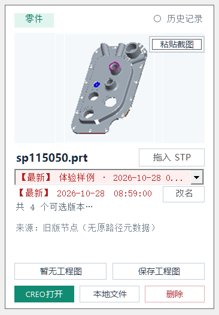
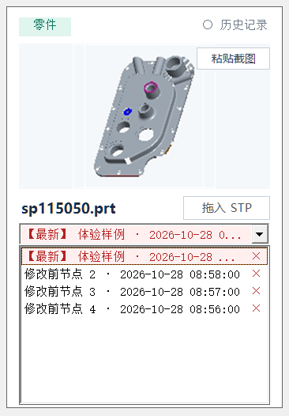
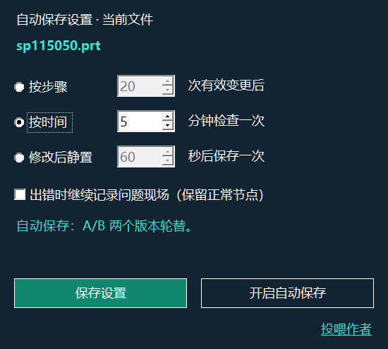

# Creo Work Index · V578

用 Creo 做设计，最怕的有时候不是模型复杂，而是**改了一步之后，前面做的东西突然出错了**。

这些情况，我在工作中都遇到过：

- 修改一个特征，关联关系发生冲突，**模型树一片红**；
- 双击编辑模型中的某个特征，触发重新生成，结果模型出错；
- 移除或替换某个特征后，Creo 一直在计算，等了很久也无法中断。

有时候，出错前的工作还没来得及保存。看着模型卡在那里，最想知道的就是：

**刚才做的设计，还有没有机会找回来？**

所以我想做这个插件：在这些容易出错的操作前，尽量给模型留一份状态。遇到问题时，看看能不能把之前的工作挽回。

Model cards, saved nodes, per-file autosave and error protection for Windows x64. The unified installer contains **version-specific components for Creo 5–13**. It cannot prevent Creo crashes or guarantee recovery of every unsaved operation.

[中文说明](README.zh-CN.md) · [Full V578 user guide (Chinese)](docs/USER_GUIDE.zh-CN.md)

## Download and install

[V578 unified Chinese installer](https://github.com/zewei2580-tech/creo-work-index/releases/download/v578/CreoWorkIndex_Unified_V578_Chinese.zip) · [SHA-256](https://github.com/zewei2580-tech/creo-work-index/releases/download/v578/CreoWorkIndex_Unified_V578_Chinese.zip.sha256) · [Release notes](https://github.com/zewei2580-tech/creo-work-index/releases/tag/v578)

Extract the complete archive, keep the shared and versions folders, and run the outer Setup.exe. Select your actual Creo version and startup configuration. New installations use separate empty program and library directories; existing installations use Upgrade and retain their settings. Save your work and exit Creo and the index interface first.

All nine SDK builds and installation checks passed. Full live CAD acceptance has **not** been completed on every Creo version. Test with copies before production use. This repository distributes installers and documentation, not software source code.

## V578 recovery updates

This update revises current-model activation after recovery in a new Creo session and adds **重置并重新加载索引器** to the floating entry's right-click menu. Reset waits for Creo acknowledgement before clearing queued restore requests and UI wait state; it retains models and saved nodes. A blocked Creo computation must return before it can acknowledge reset. Existing author tools and licenses remain compatible. Protocol and regression checks passed; live recovery still needs model-specific retesting.

## Current model cards

These are actual V574 UI renders using isolated demonstration data. A fresh empty library receives one SP115050 sample node; the four nodes above illustrate selection. Existing libraries are not populated on upgrade, and deleting the sample does not cause it to return. The sample retains its original Creo 3.0 file; its embedded thumbnail has limited resolution.

Selecting a node changes the preview only. Double-click the preview or use **CREO打开** to open a separate working copy. **本地文件** opens Windows Explorer at the node file; internal metadata remains visible and must not be removed manually.

Since V574, the interface embeds the list in the card to reduce unexpected closing during transient focus changes. It supports scrolling, selection and row deletion. **改名** updates the node label. Row **×** moves eligible manual nodes to the recycle bin; automatic, locked, in-use and recovery-dependent nodes are protected. The recycle bin supports selecting a card, restoring it or permanently clearing it.

The card-level **删除** action has a broader scope and may permanently delete the entire local backup record without the recycle bin. Read the confirmation carefully.

## Autosave and error protection

Choose one mode: effective changes (preset 20), timed checks (default 5 minutes), or idle after modification (preset 60 seconds). Existing settings survive upgrades. Counts are design changes, not clicks; reaching a threshold still requires Creo to allow a safe save. Automatic versions rotate between A/B.

Autosave and ordinary features are free. Error protection has a 30-day trial followed by offline activation; it is a separate VIP switch. It creates or reuses pre-operation snapshots only for supported contexts, with identity and completeness checks. Existing matching snapshots remain recoverable after trial expiry.

After about 20 seconds without idle feedback during a protected operation, the user may continue waiting or explicitly end that session and restore in a new one. Long computation is not necessarily failure. Ending a session can lose unsaved changes in other unprotected models. Verify the resulting model tree and geometry.

## Projects, updates and help

The [user guide](docs/USER_GUIDE.zh-CN.md) covers projects, backup and migration, independent copies, drawings, STP, cleanup, licensing and uninstalling. Complex assemblies and external references require their own validation.

Use the outer Setup.exe for updates, rollback and uninstall. The library is retained by default. This repository's older installer files have been removed from the current branch, while Git history remains.

WeChat: **zewei2580** · Email: [992823232@qq.com](mailto:992823232@qq.com)
