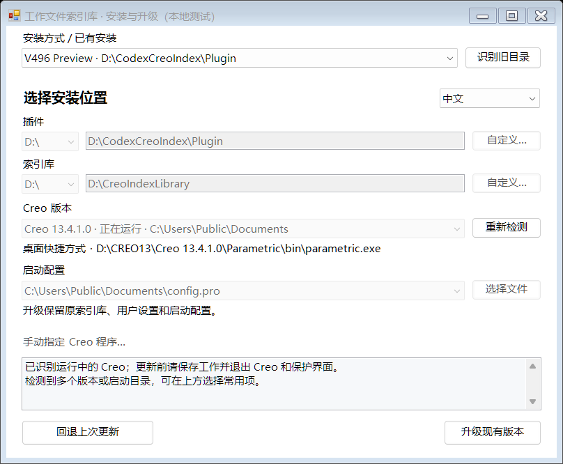
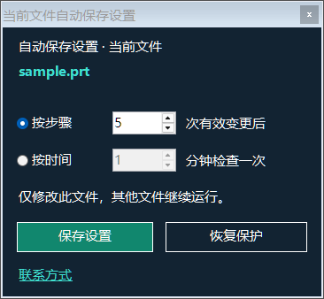

# Creo 工作文件索引库

适用于 **Windows 64 位，包含 Creo 5–13 各版本对应组件**。最初我想解决 Creo 崩溃后返工的问题，从轨迹恢复做起，几个月里逐渐做成模型卡片、保存节点、工程图、项目资料和自动保存。它不能防止 Creo 崩溃，但能帮我找到近期工作并返回之前留存的状态。

[English](README.md)

## 下载

- [V574 中文版统一安装包](https://github.com/zewei2580-tech/creo-work-index/releases/download/v574/CreoWorkIndex_Unified_V574_Chinese.zip) · [SHA-256 校验](https://github.com/zewei2580-tech/creo-work-index/releases/download/v574/CreoWorkIndex_Unified_V574_Chinese.zip.sha256)

包含 Creo 5–13 九套对应 SDK 构建。构建及安装检查通过，尚未在每个版本完成全部真实 CAD 操作验收。旧安装包已从当前分支移除，Git 历史仍保留。本仓库提供安装包和说明，不发布软件源码。

## 安装或覆盖升级

解压后运行 **Setup.exe**。首次安装要选好插件目录和**索引库目录**，可放在可用的 C、D、E、F 等本地盘；后续节点和导入的项目资料会由索引库管理。安装器会识别 Creo 版本，选择你实际使用的 Creo 5–13 版本 及其启动配置。

已有安装选择**升级现有版本**。安装器识别旧程序，保留索引库和设置，更新注册的插件文件，并备份原程序；更新失败可自动回退，更新中断后也可恢复。先保存工作并正常退出 Creo 和索引库界面，再运行安装器，完成后重新启动 Creo。

## 第一次完整体验

打开一个测试零件，摆好角度，点击桌面的 **CREO 悬浮入口**，选“保存当前状态”。随后打开索引库，找到对应卡片和预览；点“CREO打开”可从保存节点的**独立工作副本**继续。如果同名装配或子零件仍在 Creo 内存中，恢复会停止并说明冲突。只关闭模型窗口，不一定已从内存移除。

我更提倡在关键阶段按需点“保存当前状态”。它先正常保存工作文件，再把原生模型文件复制成独立历史节点。自动保存仅在 A/B 两个槽位轮替；新节点保存失败时，已有 A/B 仍保留。工作原件和历史节点分开管理。

手动保存一个属于已加载装配的子零件后，悬浮窗会询问是否**同时保存装配节点**。可以保存，也可以暂不保存。保存装配节点会带上已识别的原生依赖件，不会给每个子零件自动生成一堆卡片。即使切换了当前 Creo 窗口，这个提示仍指向显示的装配。

## 每个文件单独设置自动保存

新文件第一次只问是否开启；约 12 秒没有选择，询问会自动收起，同一会话切回该文件也不会反复弹出。默认**按时间每 5 分钟检查，预设为 20 步、修改后静置 60 秒**。系统累计的是设计变更，不是鼠标点击；停着不动不会增加次数。之后再点悬浮窗的“自动保存设置”，面板顶部明确显示当前文件名，可改成按步骤或按时间，并分别设置次数或分钟。不同文件记住自己的设置；暂停和恢复只作用于该文件。执行成功后设置框自动关闭，切换文件也会收起旧设置框。

按次数时，图标右侧只显示 `2/5`；按时间时，图标下方显示 `01:20/05:00`。达到条件不等于已经保存成功，还要等 Creo 安全空闲。按时间检查时若模型没改变，会提示“模型未改变，无需保存”，不生成重复节点。大型装配、逆向点云或 STL 的保存可能卡顿，必要时调大间隔，或暂停自动保护，改为按需手动保存。

## 从项目卡片继续工作

我把整个项目资料文件夹归入对应项目。下次打开 Creo 和索引库，就能看近期卡片，再从项目文件夹入口找到资料，不用一层层翻文件夹。模型卡片也可以关联 Creo 工程图。

此前 V496 已用 Creo 13 的简单装配和两个测试零件验证原生保存与复制、零件后补存装配、同名依赖恢复拦截、A/B 失败保留，以及两个文件使用不同保存方式。族表、骨架、复杂外部参照、简化表示和 Windchill 管理模型不在这轮实测范围内。建议先用自己的测试项目完成一次保存与恢复。

交流邮箱：[zewei2580@gmail.com](mailto:zewei2580@gmail.com)。

## V574 更新
节点选择改为卡片内嵌列表，减少短暂失焦时自动收起。首次安装到空索引库时内置 SP115050 体验样例；现有库升级保持不变。出错保护提供 30 天试用及离线激活，自动保存和其他功能免费。

## 卸载
退出 Creo 和保护界面，完整解压安装包，运行与 uninstall-files.txt 同目录的 Uninstall.exe，选择插件安装目录。默认保留索引库；只有需要永久删除全部索引历史时才勾选删除数据。共用的 VC++ 运行库保留。

## 版本兼容
请使用上方统一安装包，不再单独下载旧 SDK 测试安装包。
